# Accommerce — ERD SQL Revisi 3.4

> **Versi:** 3.4 · 10 Okt 2026  
> **Basis:** ERD v3.3 + Revisi v3.4  
> **Status:** Skema SQL Dibekukan, Kode Ilustratif, Spesifikasi Akhir  

---

## Changelog Revisi 3.4 (v3.3 → v3.4)

| # | Poin Revisi | Perubahan di v3.4 |
|---|---|---|
| **1** | **Pembekuan Skema & Kode Ilustratif** | Menghentikan iterasi pseudo-code dan menandai contoh kode sebagai ilustratif. Skema SQL dibekukan. |
| **2** | **Kolom `points_skipped_reason`** | Menambahkan `points_skipped_reason VARCHAR(30) NULL` pada tabel `orders`. `points_awarded_at` hanya diisi saat poin benar-benar diberikan. |
| **3** | **Spesifikasi `reverse`** | Nolkan `remaining_points` baris earn; buat dua ledger `reversal_base` (`counts_for_tier=true`) & `reversal_bonus`; `tier_points` tidak boleh < 0; restok oleh Orders, Loyalty mendengar `OrderReturned`. |
| **4** | **Spesifikasi `redeemPoints`** | Menambahkan syarat validasi saldo total: `points_balance >= points`. |
| **5** | **Spesifikasi `IssueTierBenefitsJob`** | Bronze 1x/kuartal hanya di bulan pertama kuartal. Gratis ongkir bulanan (1/2/4/4/4) dengan plafon diteruskan ke `VoucherService`. |
| **6** | **Penegakan `Review`** | Ulasan hanya dapat dilakukan dari pesanan dengan status `completed`. |
| **7** | **Kebijakan Zona Waktu** | Menggunakan satu zona waktu konsisten (misal `app.timezone` Asia/Jakarta tanpa `->utc()`). Perbaikan `yearlyOn` ke `->timezone('Asia/Jakarta')`. |

## Changelog Revisi 3.3 (v3.2 → v3.3)

| # | Poin Revisi | Perubahan di v3.3 |
|---|---|---|
| **0** | **Pemulihan Konten v3.1** | Memulihkan: (1) Alur Job Akhir Tahun `Bus::chain` + scheduler, (2) Aturan registrasi storefront `CompanyRegistered` sinkron + `firstOrCreate`, (3) Kode accessor virtual `payment_status`, (4) Alur decoupled `ReviewStored`. |
| **1** | **Shared Contract Event `ReviewStored`** | Kontrak event `ReviewStored` dipindahkan ke namespace bersama `App\Support\Events\ReviewStored`. Modul Loyalty tidak lagi mengimpor namespace modul Review. Kolom `reviews.points_awarded` **dihapus** karena audit poin tersentralisasi di `point_ledger`. |
| **2** | **Daily Scanner `AwardEligiblePointsJob` & Dummy Price** | `AwardEligiblePointsJob` dijadikan daily scheduled scanner yang menyeleksi `Order::pointsEligible()` lalu mendispatch job antrean `ProcessOrderPointsJob` (`ShouldQueue`) per order. Pesanan dengan flag `has_dummy_price_item = true` secara default **tidak mendapat poin** (menunggu konfirmasi O-01). |
| **3** | **Standarisasi `payment_type`** | Tipe pembayaran distandarisasi menjadi `'direct' \| 'net'` (sesuai kerangka dan Dokumen 04), bukan `'invoice'`. |
| **4** | **Idempotent Check & Poin Matang `redeemPoints`** | Setelah mengunci akun loyalti (`lockForUpdate`), dicek terlebih dahulu apakah record `redemptions` dengan `idempotency_key` sudah ada; jika sudah, langsung dikembalikan (idempotent early return). Poin matang wajib memenuhi syarat usia `>= 30 hari`, `remaining_points > 0`, dan `(expires_at IS NULL OR expires_at > now())` (belum kedaluwarsa). |
| **5** | **Koreksi Batas Kuota Bulanan** | Query kalkulasi kuota bulanan e-wallet (maks 5.000 poin) menerapkan konversi UTC eksplisit: `now('Asia/Jakarta')->startOfMonth()->utc()` dan `->endOfMonth()->utc()` (atau berbasis konfigurasi `app.timezone = 'Asia/Jakarta'`). |
| **6** | **Proteksi `reverseForOrder`** | Logika pembalikan pesanan (`reverseForOrder`) hanya menarik poin (ledger reversal) jika `points_awarded_at IS NOT NULL`. Pengembalian stok fisik barang tetap dieksekusi secara independen. |
| **7** | **`IssueTierBenefitsJob` di Loyalty** | Menambahkan job berkala `IssueTierBenefitsJob` di modul Loyalty untuk menerbitkan benefit otomatis via `VoucherService` milik Promo: voucher diskon kategori Bronze 1x per kuartal (`quarter_key`), serta voucher gratis ongkir bulanan (Silver: 2 slot, Gold: 4 slot, Platinum: 4 slot per bulan). |
| **8** | **Pembersihan Kolom `weight`** | Kolom `weight` dihapus dari tabel `products` dan `variants` karena kalkulasi ongkir belum menggunakan berat fisik. |
| **9** | **Pembaruan Label Migrasi** | Label penomoran modul diubah dari klaim "sinkron dengan PRD v2" menjadi **Batch Migrasi 1..8** yang konsisten dengan urutan ketergantungan foreign key. |
| **10** | **Catatan Tambahan O-01** | Menambahkan catatan bahwa aturan usia minimum 30 hari untuk penukaran voucher juga **menunggu konfirmasi Nabil**. |

---

## Graf Dependensi Modul (Acyclic)

```
       ┌───────────┐       ┌───────────┐       ┌───────────┐
       │ Accounts  │       │  Catalog  │       │  Content  │
       └─────┬─────┘       └─────┬─────┘       └───────────┘
             │                   │
             ├──────────┬────────┤
             │          │        │
             ▼          │        │
       ┌───────────┐    │        │
       │   Promo   │◄───┘        │ (Promo requires Catalog karena vouchers.category_id)
       └─────┬─────┘             │
             │                   │
             ├──────────┬────────┤
             │          │        │
             ▼          ▼        │
       ┌───────────┐ ┌─────────┐ │
       │   Cart    │ │ Orders  │ │
       └───────────┘ └────┬────┘ │
                          │      │
             ┌────────────┴──────┼───────────────────┐
             │                   │                   │
             ▼                   │                   ▼
       ┌───────────┐             │             ┌───────────┐
       │  Loyalty  │             └────────────►│  Review   │
       └───────────┘                           └───────────┘

Dependensi Final:
1. Accounts, Catalog, Content: Mandiri
2. Promo: Accounts, Catalog
3. Cart: Accounts, Catalog, Promo
4. Orders: Accounts, Catalog, Promo
5. Loyalty: Accounts, Orders, Promo
6. Review: Accounts, Catalog, Orders
```

---

## Skema Database Lengkap (SQL)

### ═══ MODULE: ACCOUNTS ═══

```sql
-- 2026_01_01_000001_create_companies_table.php
CREATE TABLE companies (
    id              BIGINT UNSIGNED AUTO_INCREMENT PRIMARY KEY,
    name            VARCHAR(255) NOT NULL,
    npwp            VARCHAR(30) UNIQUE NULL,
    sppkp           VARCHAR(50) NULL,
    phone           VARCHAR(30) NULL,
    email           VARCHAR(255) NULL,
    address         TEXT NULL,
    is_verified     BOOLEAN DEFAULT FALSE,
    created_at      TIMESTAMP,
    updated_at      TIMESTAMP
);

-- 2026_01_01_000002_add_company_to_users.php
-- Patch tabel users bawaan Laravel
ALTER TABLE users
    ADD COLUMN phone        VARCHAR(30) NULL AFTER email,
    ADD COLUMN company_id   BIGINT UNSIGNED NULL AFTER phone,
    ADD COLUMN company_role ENUM('admin','member') NULL AFTER company_id,
    -- NULL hanya untuk user panel admin internal.
    -- Storefront user wajib memiliki company_id + company_role='admin'.
    ADD CONSTRAINT fk_users_company
        FOREIGN KEY (company_id) REFERENCES companies(id) ON DELETE RESTRICT;

-- 2026_01_01_000003_create_addresses_table.php
CREATE TABLE addresses (
    id              BIGINT UNSIGNED AUTO_INCREMENT PRIMARY KEY,
    user_id         BIGINT UNSIGNED NOT NULL,
    label           VARCHAR(50) NOT NULL DEFAULT 'Rumah',
    recipient_name  VARCHAR(255) NOT NULL,
    phone           VARCHAR(30) NOT NULL,
    province        VARCHAR(100) NOT NULL,
    city            VARCHAR(100) NOT NULL,
    address         TEXT NOT NULL,
    postal_code     VARCHAR(10) NOT NULL,
    is_default      BOOLEAN DEFAULT FALSE,
    created_at      TIMESTAMP,
    updated_at      TIMESTAMP,

    INDEX idx_user_id (user_id),
    FOREIGN KEY (user_id) REFERENCES users(id) ON DELETE CASCADE
);
```

> **[PULIH v3.1 / REVISI v3.3] Aturan Registrasi Storefront & Lifecycle Akun Loyalti:**  
> `AccountController::register()` selalu:
> 1. INSERT `companies` (`npwp=NULL` untuk user perorangan).
> 2. INSERT `users` dengan `company_id` dan `company_role = 'admin'`.
> 3. Emit event `CompanyRegistered($company)`.
> 4. Listener `CreateLoyaltyAccount` (**sinkron**) di modul Loyalty menangkap event ini dan memanggil `LoyaltyService::createAccount($company->id)` secara idempotent dengan `firstOrCreate`:
> ```php
> public function createAccount(int $companyId): LoyaltyAccount
> {
>     return LoyaltyAccount::firstOrCreate(
>         ['company_id' => $companyId],
>         [
>             'tier_points'      => 0,
>             'points_balance'   => 0,
>             'current_tier'     => 'classic',
>             'tier_valid_until' => Carbon::now()->addYear()->endOfYear()->toDateString(), // 31 Des tahun depan
>         ]
>     );
> }
> ```
> `company_id = NULL` dan `company_role = NULL` hanya digunakan untuk staf internal yang dibuat via panel Filament.

---

### ═══ MODULE: CATALOG ═══

```sql
-- 2026_02_01_000001_create_catalog_tables.php
CREATE TABLE brands (
    id              BIGINT UNSIGNED AUTO_INCREMENT PRIMARY KEY,
    name            VARCHAR(255) NOT NULL,
    slug            VARCHAR(255) NOT NULL UNIQUE,
    logo_url        VARCHAR(500) NULL,
    deleted_at      TIMESTAMP NULL,
    created_at      TIMESTAMP,
    updated_at      TIMESTAMP
);

CREATE TABLE categories (
    id              BIGINT UNSIGNED AUTO_INCREMENT PRIMARY KEY,
    name            VARCHAR(255) NOT NULL,
    slug            VARCHAR(255) NOT NULL UNIQUE,
    full_path       VARCHAR(500) NULL,
    parent_id       BIGINT UNSIGNED NULL,
    is_addon        BOOLEAN DEFAULT FALSE,
    is_brand_group  BOOLEAN DEFAULT FALSE,
    product_count   INT DEFAULT 0,
    sort_order      INT DEFAULT 0,
    deleted_at      TIMESTAMP NULL,
    created_at      TIMESTAMP,
    updated_at      TIMESTAMP,

    FOREIGN KEY (parent_id) REFERENCES categories(id) ON DELETE RESTRICT
);

-- [REVISI v3.2 & v3.3 #8] Kolom tanpa sumber data dan weight telah dihapus
CREATE TABLE products (
    id                  BIGINT UNSIGNED AUTO_INCREMENT PRIMARY KEY,
    sku                 VARCHAR(100) NULL,
    name                VARCHAR(500) NOT NULL,
    slug                VARCHAR(500) NOT NULL UNIQUE,
    type                ENUM('simple','variable') DEFAULT 'simple',
    product_type        ENUM('regular','rental','license') DEFAULT 'regular',
    regular_price       BIGINT UNSIGNED NOT NULL DEFAULT 0,
    sale_price          BIGINT UNSIGNED NULL,
    is_dummy_price      BOOLEAN DEFAULT FALSE,
    is_price_outlier    BOOLEAN DEFAULT FALSE,
    is_featured         BOOLEAN DEFAULT FALSE,
    is_flash_sale       BOOLEAN DEFAULT FALSE,
    is_addon            BOOLEAN DEFAULT FALSE,
    stock               INT DEFAULT 0,
    brand_id            BIGINT UNSIGNED NULL,
    sort_order          INT DEFAULT 0,
    description         LONGTEXT NULL,
    short_description   TEXT NULL,
    source_id           VARCHAR(50) NULL,
    deleted_at          TIMESTAMP NULL,
    created_at          TIMESTAMP,
    updated_at          TIMESTAMP,

    INDEX idx_slug (slug),
    INDEX idx_sort_order (sort_order),
    INDEX idx_brand_id (brand_id),
    INDEX idx_product_type (product_type),
    FOREIGN KEY (brand_id) REFERENCES brands(id) ON DELETE RESTRICT
);

CREATE TABLE category_product (
    category_id     BIGINT UNSIGNED NOT NULL,
    product_id      BIGINT UNSIGNED NOT NULL,
    PRIMARY KEY (category_id, product_id),
    INDEX idx_product_id (product_id),
    FOREIGN KEY (category_id) REFERENCES categories(id) ON DELETE CASCADE,
    FOREIGN KEY (product_id) REFERENCES products(id) ON DELETE CASCADE
);

CREATE TABLE product_images (
    id              BIGINT UNSIGNED AUTO_INCREMENT PRIMARY KEY,
    product_id      BIGINT UNSIGNED NOT NULL,
    url             VARCHAR(500) NOT NULL,
    sort_order      INT DEFAULT 0,
    created_at      TIMESTAMP,
    updated_at      TIMESTAMP,

    INDEX idx_product_id (product_id),
    FOREIGN KEY (product_id) REFERENCES products(id) ON DELETE CASCADE
);

CREATE TABLE variants (
    id                  BIGINT UNSIGNED AUTO_INCREMENT PRIMARY KEY,
    product_id          BIGINT UNSIGNED NOT NULL,
    source_id           VARCHAR(50) NULL,
    sku                 VARCHAR(100) NULL,
    name                VARCHAR(500) NOT NULL,
    regular_price       BIGINT UNSIGNED NOT NULL DEFAULT 0,
    sale_price          BIGINT UNSIGNED NULL,
    is_dummy_price      BOOLEAN DEFAULT FALSE,
    is_price_outlier    BOOLEAN DEFAULT FALSE,
    stock               INT DEFAULT 0,
    deleted_at          TIMESTAMP NULL,
    created_at          TIMESTAMP,
    updated_at          TIMESTAMP,

    INDEX idx_product_id (product_id),
    FOREIGN KEY (product_id) REFERENCES products(id) ON DELETE RESTRICT
);

CREATE TABLE variant_images (
    id              BIGINT UNSIGNED AUTO_INCREMENT PRIMARY KEY,
    variant_id      BIGINT UNSIGNED NOT NULL,
    url             VARCHAR(500) NOT NULL,
    sort_order      INT DEFAULT 0,

    INDEX idx_variant_id (variant_id),
    FOREIGN KEY (variant_id) REFERENCES variants(id) ON DELETE CASCADE
);

-- [REVISI v3.2 #1] Atribut Polimorfik v3 dikembalikan
CREATE TABLE product_attributes (
    id                  BIGINT UNSIGNED AUTO_INCREMENT PRIMARY KEY,
    name                VARCHAR(100) NOT NULL,
    value               VARCHAR(500) NOT NULL,
    attributable_id     BIGINT UNSIGNED NOT NULL,
    attributable_type   VARCHAR(100) NOT NULL,

    INDEX idx_attributable (attributable_type, attributable_id)
);

-- 2026_02_01_000002_create_stock_movements_table.php
-- [REVISI v3.2 #1] Definisi v3 dengan delta & reason lengkap dikembalikan
CREATE TABLE stock_movements (
    id              BIGINT UNSIGNED AUTO_INCREMENT PRIMARY KEY,
    product_id      BIGINT UNSIGNED NOT NULL,
    variant_id      BIGINT UNSIGNED NULL,
    delta           INT NOT NULL, -- Negatif = berkurang, Positif = bertambah
    reason          ENUM(
                      'order',
                      'cancel',
                      'expired',
                      'returned',
                      'adjustment',
                      'seeder'
                    ) NOT NULL,
    reference_id    BIGINT UNSIGNED NULL,
    note            VARCHAR(255) NULL,
    created_at      TIMESTAMP,

    INDEX idx_product_id (product_id),
    FOREIGN KEY (product_id) REFERENCES products(id) ON DELETE RESTRICT,
    FOREIGN KEY (variant_id) REFERENCES variants(id) ON DELETE RESTRICT
);
```

---

### ═══ MODULE: PROMO ═══

```sql
-- 2026_02_02_000001_create_promo_tables.php
CREATE TABLE promo_codes (
    id              BIGINT UNSIGNED AUTO_INCREMENT PRIMARY KEY,
    code            VARCHAR(50) NOT NULL UNIQUE,
    label           VARCHAR(255) NOT NULL,
    type            ENUM('percent','fixed') NOT NULL,
    value           BIGINT UNSIGNED NOT NULL,
    min_order       BIGINT UNSIGNED DEFAULT 0,
    max_uses        INT NULL,
    used_count      INT DEFAULT 0,
    valid_from      TIMESTAMP NULL,
    valid_until     TIMESTAMP NULL,
    is_active       BOOLEAN DEFAULT TRUE,
    created_at      TIMESTAMP,
    updated_at      TIMESTAMP
);

CREATE TABLE vouchers (
    id              BIGINT UNSIGNED AUTO_INCREMENT PRIMARY KEY,
    code            VARCHAR(100) NOT NULL UNIQUE,
    title           VARCHAR(255) NOT NULL,
    type            ENUM('fixed','percent','free_shipping') NOT NULL,
    discount_value  BIGINT UNSIGNED NOT NULL,
    min_order       BIGINT UNSIGNED DEFAULT 0,
    company_id      BIGINT UNSIGNED NOT NULL,
    -- [REVISI v3.2 #6] Relasi ke categories memerlukan Catalog
    category_id     BIGINT UNSIGNED NULL,
    source          ENUM('tier_bronze','redeem','free_shipping') NOT NULL,
    points_cost     INT NULL,
    used_at         TIMESTAMP NULL,
    expires_at      TIMESTAMP NULL,
    quarter_key     VARCHAR(7) NULL, -- Format "2026-Q4" (untuk tier_bronze)
    month_key       VARCHAR(7) NULL, -- Format "2026-10" (untuk free_shipping)
    -- [REVISI v3.2 #5] Slot 1..4 untuk kuota free shipping bulanan (Silver: 2, Gold: 4)
    slot            TINYINT UNSIGNED NULL,
    created_at      TIMESTAMP,
    updated_at      TIMESTAMP,

    UNIQUE KEY uq_bronze_per_quarter (company_id, source, quarter_key),
    UNIQUE KEY uq_free_shipping_slot (company_id, source, month_key, slot),
    FOREIGN KEY (company_id) REFERENCES companies(id) ON DELETE RESTRICT,
    FOREIGN KEY (category_id) REFERENCES categories(id) ON DELETE RESTRICT
);
```

---

### ═══ MODULE: CART ═══

```sql
-- 2026_02_03_000001_create_cart_tables.php
CREATE TABLE carts (
    id              BIGINT UNSIGNED AUTO_INCREMENT PRIMARY KEY,
    user_id         BIGINT UNSIGNED NULL,
    session_id      VARCHAR(100) NULL,
    promo_code_id   BIGINT UNSIGNED NULL,
    voucher_id      BIGINT UNSIGNED NULL,
    created_at      TIMESTAMP,
    updated_at      TIMESTAMP,

    INDEX idx_user_id (user_id),
    INDEX idx_session_id (session_id),
    FOREIGN KEY (user_id) REFERENCES users(id) ON DELETE CASCADE,
    FOREIGN KEY (promo_code_id) REFERENCES promo_codes(id) ON DELETE SET NULL,
    FOREIGN KEY (voucher_id) REFERENCES vouchers(id) ON DELETE SET NULL
);

CREATE TABLE cart_items (
    id              BIGINT UNSIGNED AUTO_INCREMENT PRIMARY KEY,
    cart_id         BIGINT UNSIGNED NOT NULL,
    product_id      BIGINT UNSIGNED NOT NULL,
    variant_id      BIGINT UNSIGNED NULL,
    quantity        INT NOT NULL DEFAULT 1,
    rental_start    DATE NULL,
    rental_end      DATE NULL,
    rental_start_time VARCHAR(5) NULL,
    rental_end_time   VARCHAR(5) NULL,
    created_at      TIMESTAMP,
    updated_at      TIMESTAMP,

    FOREIGN KEY (cart_id) REFERENCES carts(id) ON DELETE CASCADE,
    FOREIGN KEY (product_id) REFERENCES products(id) ON DELETE CASCADE,
    FOREIGN KEY (variant_id) REFERENCES variants(id) ON DELETE CASCADE
);

CREATE TABLE wishlists (
    id              BIGINT UNSIGNED AUTO_INCREMENT PRIMARY KEY,
    user_id         BIGINT UNSIGNED NOT NULL,
    product_id      BIGINT UNSIGNED NOT NULL,
    created_at      TIMESTAMP,

    UNIQUE KEY uq_user_product (user_id, product_id),
    FOREIGN KEY (user_id) REFERENCES users(id) ON DELETE CASCADE,
    FOREIGN KEY (product_id) REFERENCES products(id) ON DELETE CASCADE
);
```

---

### ═══ MODULE: ORDERS ═══

```sql
-- 2026_02_04_000001_create_orders_table.php
CREATE TABLE orders (
    id                      BIGINT UNSIGNED AUTO_INCREMENT PRIMARY KEY,
    number                  VARCHAR(20) NOT NULL UNIQUE,
    user_id                 BIGINT UNSIGNED NOT NULL,
    company_id              BIGINT UNSIGNED NOT NULL,

    -- Alur Status Lengkap:
    -- pending_payment       → awaiting_verification (upload bukti / webhook)
    -- awaiting_verification → paid (verifikasi manual/sistem)
    -- paid                  → processing (proses gudang)
    -- processing            → packed (dikemas)
    -- packed                → shipped (dikirim dengan tracking_number)
    -- shipped               → completed (diterima user / auto-complete H+7)
    -- completed             → returned (retur purna jual: memicu reverseForOrder poin & restok)
    -- * cancelled           → terjadi sebelum barang dikirim
    -- * returned            → terjadi dari shipped (gagal antar) atau completed (retur resmi)
    status                  ENUM(
                              'pending_payment',
                              'awaiting_verification',
                              'paid',
                              'processing',
                              'packed',
                              'shipped',
                              'completed',
                              'returned',
                              'cancelled'
                            ) DEFAULT 'pending_payment',

    payment_type            VARCHAR(20) DEFAULT 'direct', -- 'direct' atau 'net' (kerangka & Dokumen 04)
    net_days                TINYINT UNSIGNED NULL,

    goods_subtotal          BIGINT UNSIGNED NOT NULL,
    discount_on_goods       BIGINT UNSIGNED DEFAULT 0,
    ppn                     BIGINT UNSIGNED DEFAULT 0,
    shipping_cost           BIGINT UNSIGNED DEFAULT 0,
    admin_fee               BIGINT UNSIGNED DEFAULT 0,
    grand_total             BIGINT UNSIGNED NOT NULL,
    has_dummy_price_item    BOOLEAN DEFAULT FALSE,

    promo_code_id           BIGINT UNSIGNED NULL,
    voucher_id              BIGINT UNSIGNED NULL,

    shipping_method         VARCHAR(100) NULL,
    shipping_label          VARCHAR(255) NULL,
    tracking_number         VARCHAR(100) NULL,
    shipping_address        JSON NOT NULL,

    payment_method          VARCHAR(50) NULL,
    -- payment_status bersifat virtual accessor Eloquent, tidak dibuat kolom fisik
    paid_at                 TIMESTAMP NULL,

    completed_at            TIMESTAMP NULL,
    shipped_at              TIMESTAMP NULL,
    invoice_paid_at         TIMESTAMP NULL,
    points_awarded_at       TIMESTAMP NULL,
    points_skipped_reason   VARCHAR(30) NULL,

    customer_notes          TEXT NULL,
    admin_notes             TEXT NULL,

    created_at              TIMESTAMP,
    updated_at              TIMESTAMP,

    INDEX idx_status (status),
    INDEX idx_user_id (user_id),
    INDEX idx_company_id (company_id),
    INDEX idx_points_awarded_at (points_awarded_at),
    FOREIGN KEY (user_id) REFERENCES users(id) ON DELETE RESTRICT,
    FOREIGN KEY (company_id) REFERENCES companies(id) ON DELETE RESTRICT,
    FOREIGN KEY (promo_code_id) REFERENCES promo_codes(id) ON DELETE RESTRICT,
    FOREIGN KEY (voucher_id) REFERENCES vouchers(id) ON DELETE SET NULL
);

CREATE TABLE order_status_history (
    id              BIGINT UNSIGNED AUTO_INCREMENT PRIMARY KEY,
    order_id        BIGINT UNSIGNED NOT NULL,
    from_status     VARCHAR(30) NULL,
    to_status       VARCHAR(30) NOT NULL,
    actor_id        BIGINT UNSIGNED NULL,
    notes           TEXT NULL,
    created_at      TIMESTAMP NOT NULL,

    INDEX idx_order_id (order_id),
    FOREIGN KEY (order_id) REFERENCES orders(id) ON DELETE RESTRICT,
    FOREIGN KEY (actor_id) REFERENCES users(id) ON DELETE SET NULL
);

CREATE TABLE order_items (
    id              BIGINT UNSIGNED AUTO_INCREMENT PRIMARY KEY,
    order_id        BIGINT UNSIGNED NOT NULL,
    product_id      BIGINT UNSIGNED NOT NULL,
    variant_id      BIGINT UNSIGNED NULL,
    product_name    VARCHAR(500) NOT NULL,
    variant_name    VARCHAR(255) NULL,
    sku             VARCHAR(100) NULL,
    unit_price      BIGINT UNSIGNED NOT NULL,
    quantity        INT NOT NULL,
    subtotal        BIGINT UNSIGNED NOT NULL,
    is_dummy_price  BOOLEAN DEFAULT FALSE,
    rental_start    DATE NULL,
    rental_end      DATE NULL,
    rental_days     INT NULL,
    created_at      TIMESTAMP,
    updated_at      TIMESTAMP,

    INDEX idx_order_id (order_id),
    FOREIGN KEY (order_id) REFERENCES orders(id) ON DELETE RESTRICT,
    FOREIGN KEY (product_id) REFERENCES products(id) ON DELETE RESTRICT,
    FOREIGN KEY (variant_id) REFERENCES variants(id) ON DELETE RESTRICT
);

CREATE TABLE payment_proofs (
    id              BIGINT UNSIGNED AUTO_INCREMENT PRIMARY KEY,
    order_id        BIGINT UNSIGNED NOT NULL,
    file_path       VARCHAR(500) NOT NULL,
    uploaded_at     TIMESTAMP,
    verified_at     TIMESTAMP NULL,
    verified_by     BIGINT UNSIGNED NULL,

    INDEX idx_order_id (order_id),
    FOREIGN KEY (order_id) REFERENCES orders(id) ON DELETE RESTRICT,
    FOREIGN KEY (verified_by) REFERENCES users(id) ON DELETE RESTRICT
);
```

> **[PULIH v3.1 / REVISI v3.3 #3] Implementasi Accessor `payment_status` pada Model Order:**
> ```php
> namespace Modules\Orders\Models;
> 
> use Illuminate\Database\Eloquent\Model;
> 
> class Order extends Model
> {
>     public function getPaymentStatusAttribute(): string
>     {
>         return match ($this->status) {
>             'pending_payment'       => 'unpaid',
>             'awaiting_verification' => 'awaiting_verification',
>             'cancelled'             => 'cancelled',
>             default                 => 'paid', // paid, processing, packed, shipped, completed, returned
>         };
>     }
> }
> ```

---

### ═══ MODULE: LOYALTY ═══

```sql
-- 2026_02_05_000001_create_loyalty_tables.php
CREATE TABLE loyalty_accounts (
    id                  BIGINT UNSIGNED AUTO_INCREMENT PRIMARY KEY,
    company_id          BIGINT UNSIGNED NOT NULL UNIQUE,
    tier_points         INT NOT NULL DEFAULT 0,
    points_balance      INT NOT NULL DEFAULT 0,
    current_tier        ENUM('classic','bronze','silver','gold','platinum','diamond') DEFAULT 'classic',
    tier_valid_until    DATE NOT NULL,
    created_at          TIMESTAMP,
    updated_at          TIMESTAMP,

    FOREIGN KEY (company_id) REFERENCES companies(id) ON DELETE RESTRICT
);

CREATE TABLE point_ledger (
    id                      BIGINT UNSIGNED AUTO_INCREMENT PRIMARY KEY,
    loyalty_account_id      BIGINT UNSIGNED NOT NULL,
    order_id                BIGINT UNSIGNED NULL,
    review_id               BIGINT UNSIGNED NULL,
    type                    ENUM(
                              'earn_base',
                              'earn_bonus',
                              'earn_review',
                              'redeem_ewallet',
                              'redeem_voucher',
                              'expire',
                              'reversal',
                              'adjustment'
                            ) NOT NULL,
    points                  INT NOT NULL,
    remaining_points        INT NULL,
    counts_for_tier         BOOLEAN DEFAULT FALSE,
    earned_at               TIMESTAMP NOT NULL,
    expires_at              TIMESTAMP NULL,
    idempotency_key         VARCHAR(100) UNIQUE NULL,
    notes                   VARCHAR(500) NULL,
    created_at              TIMESTAMP,

    INDEX idx_loyalty_account_id (loyalty_account_id),
    INDEX idx_expires_at (expires_at),
    INDEX idx_order_id (order_id),
    FOREIGN KEY (loyalty_account_id) REFERENCES loyalty_accounts(id) ON DELETE RESTRICT,
    FOREIGN KEY (order_id) REFERENCES orders(id) ON DELETE RESTRICT
);

-- [REVISI v3.2 #4] idempotency_key UNIQUE NOT NULL dikembalikan
CREATE TABLE redemptions (
    id                      BIGINT UNSIGNED AUTO_INCREMENT PRIMARY KEY,
    loyalty_account_id      BIGINT UNSIGNED NOT NULL,
    type                    ENUM('ewallet','voucher') NOT NULL,
    points                  INT UNSIGNED NOT NULL,
    amount_idr              BIGINT UNSIGNED NOT NULL,
    ewallet_provider        VARCHAR(50) NULL,
    ewallet_account         VARCHAR(100) NULL,
    ewallet_account_name    VARCHAR(255) NULL,
    voucher_id              BIGINT UNSIGNED NULL,
    status                  ENUM('pending','paid','failed','cancelled') DEFAULT 'pending',
    requested_by            BIGINT UNSIGNED NOT NULL,
    processed_by            BIGINT UNSIGNED NULL,
    processed_at            TIMESTAMP NULL,
    rejection_reason        TEXT NULL,
    idempotency_key         VARCHAR(100) NOT NULL UNIQUE,
    created_at              TIMESTAMP,
    updated_at              TIMESTAMP,

    INDEX idx_loyalty_account_id (loyalty_account_id),
    INDEX idx_loyalty_account_created (loyalty_account_id, created_at),
    FOREIGN KEY (loyalty_account_id) REFERENCES loyalty_accounts(id) ON DELETE RESTRICT,
    FOREIGN KEY (voucher_id) REFERENCES vouchers(id) ON DELETE RESTRICT,
    FOREIGN KEY (requested_by) REFERENCES users(id) ON DELETE RESTRICT,
    FOREIGN KEY (processed_by) REFERENCES users(id) ON DELETE SET NULL
);
```

---

### [REVISI v3.4] Spesifikasi Implementasi Modul Loyalty

> **PERHATIAN: Skema SQL telah dibekukan. Ikuti spesifikasi implementasi berikut:**
> 
> **Spesifikasi Implementasi v3.4:**
> a. **reverse**: Nolkan `remaining_points` baris earn pesanan itu; buat dua baris ledger `reversal_base` (`counts_for_tier=true`) dan `reversal_bonus`; pastikan `tier_points` tidak boleh < 0; restok fisik dilakukan oleh modul Orders, modul Loyalty mendengarkan event `OrderReturned`.
> b. **redeemPoints**: Wajib `points_balance >= points` (bukan hanya mempertimbangkan poin matang).
> c. **IssueTierBenefitsJob**: Bronze 1x/kuartal HANYA diterbitkan di bulan pertama kuartal (atau diabaikan bila sudah ada); gratis ongkir bulanan 1/2/4/4/4 untuk Bronze/Silver/Gold/Platinum/Diamond dengan plafon subsidi per tier diteruskan ke `VoucherService`.
> d. **Kebijakan Zona Waktu**: Gunakan satu kebijakan zona waktu secara konsisten (`app.timezone` Asia/Jakarta tanpa menggunakan `->utc()`).
> e. **points_awarded_at**: Hanya diisi saat poin benar-benar diberikan. Jika poin dilewati (skipped), isi kolom `points_skipped_reason`.

---

### ═══ MODULE: REVIEW ═══

```sql
-- 2026_02_06_000001_create_reviews_table.php
-- [REVISI v3.2, v3.3, v3.4] company_id ditambahkan, points_awarded dihapus.
-- ATURAN: Ulasan hanya boleh dibuat dari pesanan yang berstatus 'completed'.
CREATE TABLE reviews (
    id              BIGINT UNSIGNED AUTO_INCREMENT PRIMARY KEY,
    order_id        BIGINT UNSIGNED NOT NULL,
    order_item_id   BIGINT UNSIGNED NOT NULL,
    product_id      BIGINT UNSIGNED NOT NULL,
    user_id         BIGINT UNSIGNED NOT NULL,
    company_id      BIGINT UNSIGNED NOT NULL,
    rating          TINYINT UNSIGNED NOT NULL,
    body            TEXT NOT NULL,
    is_approved     BOOLEAN DEFAULT TRUE,
    created_at      TIMESTAMP,
    updated_at      TIMESTAMP,

    UNIQUE KEY uq_company_product (company_id, product_id),
    INDEX idx_product_id (product_id),
    INDEX idx_order_id (order_id),
    FOREIGN KEY (company_id) REFERENCES companies(id) ON DELETE RESTRICT,
    FOREIGN KEY (order_id) REFERENCES orders(id) ON DELETE RESTRICT,
    FOREIGN KEY (order_item_id) REFERENCES order_items(id) ON DELETE RESTRICT,
    FOREIGN KEY (product_id) REFERENCES products(id) ON DELETE RESTRICT,
    FOREIGN KEY (user_id) REFERENCES users(id) ON DELETE RESTRICT
);
```

> **[PULIH v3.1 / REVISI v3.3 #1] Alur Event `ReviewStored` (Shared Contract):**  
> Kontrak event dipindahkan ke namespace bersama `App\Support\Events\ReviewStored` agar modul Loyalty **tidak mengimpor class dari modul Review**:
> 
> ```php
> namespace App\Support\Events;
> 
> class ReviewStored
> {
>     public function __construct(
>         public int $reviewId,
>         public int $companyId,
>         public int $userId,
>         public int $productId
>     ) {}
> }
> ```
> 
> Saat ulasan dibuat di `ReviewController::store()`:
> 1. INSERT `reviews` (tanpa kolom `points_awarded`).
> 2. Dispatch event `event(new \App\Support\Events\ReviewStored($review->id, $review->company_id, $review->user_id, $review->product_id));`.
> 3. Listener `AwardReviewPoints` di modul Loyalty menangkap event tersebut, memanggil `PointLedger::firstOrCreate` dengan `idempotency_key = "earn_review:{$event->reviewId}"` (memberikan 50 poin), dan menambahkan `points_balance` akun loyalitas. Modul Loyalty tetap bebas dari dependensi langsung ke tabel `reviews`.

---

### ═══ MODULE: CONTENT ═══

```sql
-- 2026_02_07_000001_create_content_tables.php
CREATE TABLE banners (
    id              BIGINT UNSIGNED AUTO_INCREMENT PRIMARY KEY,
    title           VARCHAR(255) NOT NULL,
    image_url       VARCHAR(500) NOT NULL,
    mobile_image_url VARCHAR(500) NULL,
    target_url      VARCHAR(500) NULL,
    sort_order      INT DEFAULT 0,
    is_active       BOOLEAN DEFAULT TRUE,
    starts_at       TIMESTAMP NULL,
    expires_at      TIMESTAMP NULL,
    created_at      TIMESTAMP,
    updated_at      TIMESTAMP
);

CREATE TABLE rfq_requests (
    id              BIGINT UNSIGNED AUTO_INCREMENT PRIMARY KEY,
    name            VARCHAR(255) NOT NULL,
    email           VARCHAR(255) NOT NULL,
    phone           VARCHAR(30) NOT NULL,
    company_name    VARCHAR(255) NOT NULL,
    message         TEXT NULL,
    status          ENUM('new','in_progress','quoted','closed') DEFAULT 'new',
    created_at      TIMESTAMP,
    updated_at      TIMESTAMP
);
```

---

## [PULIH v3.1 / REVISI v3.3] Alur Job Akhir Tahun (Chaining)

```
[31 Des 23:59 Asia/Jakarta]
                 │
                 ▼
       ┌───────────────────────────┐
       │ EvaluateYearEndTierJob    │
       └─────────┬─────────────────┘
                 │
                 │ 1. Pindai semua akun WHERE tier_valid_until = CURDATE()
                 │ 2. Evaluasi akumulasi tier_points tahun berjalan
                 │ 3. Tetapkan tier baru & set tier_valid_until (31 Des tahun depan)
                 │
                 ▼
       ┌───────────────────────────┐
       │ ResetTierPointsJob        │
       └───────────────────────────┘
                 │
                 │ 1. UPDATE loyalty_accounts SET tier_points = 0
                 │ 2. points_balance belanja/redeem TETAP UTUH (tidak direset)
                 │ 3. Catat log rotasi tahunan
                 ▼
              [Selesai]
```

**Konfigurasi Scheduler Laravel (`routes/console.php`):**
```php
use Illuminate\Support\Facades\Schedule;
use Illuminate\Support\Facades\Bus;
use Modules\Loyalty\Jobs\EvaluateYearEndTierJob;
use Modules\Loyalty\Jobs\ResetTierPointsJob;
use Modules\Loyalty\Jobs\AwardEligiblePointsScannerJob;
use Modules\Loyalty\Jobs\IssueTierBenefitsJob;

// Evaluasi & Reset Tier Tahunan (Chained)
Schedule::call(function () {
    Bus::chain([
        new EvaluateYearEndTierJob(),
        new ResetTierPointsJob(),
    ])->dispatch();
})->yearlyOn(12, 31, '23:59')->timezone('Asia/Jakarta');

// Pemindai Poin Harian (H+7 completed/net)
Schedule::job(new AwardEligiblePointsScannerJob())->dailyAt('01:00');

// Penerbitan Benefit Tier (Kuartalan & Bulanan)
Schedule::job(new IssueTierBenefitsJob())->monthlyOn(1, '00:05');
```

---

## ERD Diagram Lengkap

```mermaid
erDiagram
    companies ||--o{ users : "punya (RESTRICT)"
    companies ||--|| loyalty_accounts : "satu per perusahaan (RESTRICT)"
    companies ||--o{ orders : "pemilik pesanan (RESTRICT)"
    companies ||--o{ vouchers : "pemilik voucher (RESTRICT)"
    companies ||--o{ reviews : "entitas pengulas (RESTRICT)"

    users ||--o{ addresses : "punya (CASCADE)"
    users ||--o{ orders : "pembuat pesanan (RESTRICT)"
    users ||--o{ wishlists : "punya (CASCADE)"
    users ||--o{ reviews : "penulis ulasan (RESTRICT)"
    users ||--o{ redemptions : "pemohon (RESTRICT)"

    categories ||--o{ categories : "parent-child (RESTRICT)"
    categories }o--o{ products : "pivot category_product (CASCADE)"
    categories ||--o{ vouchers : "kategori promo (RESTRICT)"

    brands ||--o{ products : "merek (RESTRICT)"

    products ||--o{ variants : "punya (RESTRICT)"
    products ||--o{ product_images : "punya (CASCADE)"
    products ||--o{ stock_movements : "riwayat stok (RESTRICT)"
    products ||--o{ reviews : "diulas (RESTRICT)"
    products ||--o{ wishlists : "favorit (CASCADE)"
    products ||--o{ cart_items : "item cart (CASCADE)"

    variants ||--o{ variant_images : "punya (CASCADE)"
    variants ||--o{ cart_items : "varian cart (CASCADE)"
    variants ||--o{ order_items : "varian item (RESTRICT)"
    variants ||--o{ stock_movements : "stok varian (RESTRICT)"

    carts ||--o{ cart_items : "daftar item (CASCADE)"
    carts }o--o| promo_codes : "kode promo (SET NULL)"
    carts }o--o| vouchers : "voucher (SET NULL)"

    orders ||--o{ order_items : "detail item (RESTRICT)"
    orders ||--o{ payment_proofs : "bukti bayar (RESTRICT)"
    orders ||--o{ order_status_history : "audit status (RESTRICT)"
    orders }o--o| promo_codes : "diskon kode (RESTRICT)"
    orders }o--o| vouchers : "diskon voucher (RESTRICT)"

    loyalty_accounts ||--o{ point_ledger : "ledger FIFO (RESTRICT)"
    loyalty_accounts ||--o{ redemptions : "penukaran (RESTRICT)"
    redemptions }o--o| vouchers : "voucher hasil tukar (RESTRICT)"

    order_items ||--o{ reviews : "sumber review (RESTRICT)"
```



---

## Batch Migrasi 1..8 dengan Timestamp

> **[REVISI v3.3 #9]** Pelabelan menggunakan struktur **Batch Migrasi 1..8** yang urut secara timestamp dan mematuhi hierarki foreign key (Catalog mendahului Promo, Promo mendahului Cart/Orders/Loyalty).

```
Batch 0  Spatie Permission (vendor migration package)

Batch 1  Accounts
         2026_01_01_000001  create_companies_table
         2026_01_01_000002  add_company_to_users
         2026_01_01_000003  create_addresses_table

Batch 2  Catalog
         2026_02_01_000001  create_catalog_tables (brands, categories, products,
                            category_product, product_images, variants,
                            variant_images, product_attributes)
         2026_02_01_000002  create_stock_movements_table

Batch 3  Promo                                            ← Berjalan setelah Catalog
         2026_02_02_000001  create_promo_tables (promo_codes, vouchers)
                            (vouchers.company_id -> companies ✓)
                            (vouchers.category_id -> categories ✓)

Batch 4  Cart
         2026_02_03_000001  create_cart_tables (carts, cart_items, wishlists)

Batch 5  Orders
         2026_02_04_000001  create_orders_table (orders, order_status_history,
                            order_items, payment_proofs)

Batch 6  Loyalty
         2026_02_05_000001  create_loyalty_tables (loyalty_accounts, point_ledger, redemptions)

Batch 7  Review
         2026_02_06_000001  create_reviews_table (reviews)

Batch 8  Content
         2026_02_07_000001  create_content_tables (banners, rfq_requests)
```

---

## Matriks Resolusi Keputusan & Isu Terbuka

| ID | Topik | Status di v3.4 |
|---|---|---|
| **O-01** | Kuota 5.000 Poin Bulanan & Usia Poin Voucher | **Menunggu konfirmasi Nabil** (saat ini diimplementasikan: kuota 5.000 poin/bulan hanya untuk `ewallet`; aturan usia minimum 30 hari untuk voucher juga menunggu konfirmasi). |
| **O-02** | Lingkup Keunikan Review (Per perusahaan vs Per user) | **Menunggu konfirmasi Nabil** (saat ini diimplementasikan `uq_company_product` dengan penambahan kolom `company_id`). |
| **O-03** | Urutan Perhitungan PPN (Sebelum atau Sesudah Diskon) | **Belum diputuskan, tanya akuntan**. |
| **O-11** | Filament Shield vs Policy Manual | Putuskan saat implementasi Batch 0. |
| **O-13** | Komposisi `unit_price` di `order_items` | **Belum final** (mengikuti hasil resolusi O-03). |
| **O-14** | Batasan Retur Parsial | Retur saat ini **hanya untuk seluruh pesanan**. Retur parsial ditunda karena memerlukan alokasi `net_value` per item. |
| **O-15** | Benefit Gratis Ongkir Bulanan | Gratis ongkir bulanan 1/2/4/4/4 untuk Bronze/Silver/Gold/Platinum/Diamond. |
| **O-16** | Plafon Subsidi Gratis Ongkir | Plafon subsidi Gold/Platinum/Diamond belum ditentukan. |

---

## Sinkronisasi Dokumen Eksternal

1. **Dokumen 04 (`SISTEM_LOYALTI_POIN.md`)**:
   - Skema `vouchers`: penambahan `category_id` dan `slot`.
   - Skema `redemptions`: kembalikan `idempotency_key` NOT NULL UNIQUE.
   - Aturan `redeemPoints`: otorisasi admin perusahaan, nominal baku (500/1.000/2.500 dan 750/1.500/3.000), syarat poin matang berusia >= 30 hari dan belum kedaluwarsa.
   - Skema bonus tier: 0/0/5/10/20/30%, masa aktif 24 bulan, syarat rilis H+7 `completed_at` (direct) atau H+7 `invoice_paid_at` (net).
2. **`module.json`**:
   - `Promo`: `requires: ["Accounts", "Catalog"]`.
   - `Cart`: `requires: ["Accounts", "Catalog", "Promo"]`.
   - `Orders`: `requires: ["Accounts", "Catalog", "Promo"]`.
   - `Loyalty`: `requires: ["Accounts", "Orders", "Promo"]`.
   - `Review`: `requires: ["Accounts", "Catalog", "Orders"]`.
3. **Penyelarasan Urutan Migrasi**:
   - Menggunakan format **Batch Migrasi 1..8** yang kronologis dan bebas deadlock dependensi antarmodul.
4. **DECISIONS (`D-03`)**:
   - Pencatatan aturan `payment_status` virtual accessor, integritas transaksi redemption ber-slot, skema matured points, serta job scanner terjadwal.

---

## Spesifikasi Loyalty (daftar aturan, bukan kode)

- Format idempotency_key: earn_base:{order_id}, earn_bonus:{order_id}, reversal_base:{order_id}, reversal_bonus:{order_id}, earn_review:{review_id}, ledger_redeem:{redemption key}.
- Pemindai harian memilih pesanan completed + H+7 (direct: completed_at, net: invoice_paid_at) yang points_awarded_at IS NULL, lalu job per pesanan (ShouldQueue) yang mengunci order lalu akun loyalti.
- Poin dasar floor(nilai bersih/10.000); bonus floor(dasar x rate) dengan rate 0/0/5/10/20/30%; expires_at +24 bulan; counts_for_tier hanya earn_base.
- Pesanan has_dummy_price_item atau poin dasar 0: points_skipped_reason diisi, points_awarded_at tetap NULL.
- redeemPoints: company_role=admin; nominal e-wallet 500/1.000/2.500, voucher 750/1.500/3.000; points_balance >= poin; poin matang (usia >= 30 hari, remaining_points > 0, belum expired) >= poin; kuota 5.000/bulan hanya e-wallet; idempotency_key dicari dulu setelah lock akun; potong FIFO dari poin matang.
- Kuota bulanan memakai batas awal dan akhir bulan Asia/Jakarta.

---

## Catatan Implementasi (v3.4)

1. Voucher Bronze untuk tier >= bronze (Silver-Diamond mewarisi).
2. Retur: tarik juga earn_review untuk ulasan dari pesanan itu. reversal_base dan reversal_bonus = awalan idempotency_key (tipe ledger tetap 'reversal').
3. Zona waktu: pilih satu: (A) app.timezone UTC + batas eksplisit Asia/Jakarta, atau (B) app.timezone Asia/Jakarta + koneksi MySQL timezone +07:00.
4. Job Orders tambahan: AutoCompleteShippedOrdersJob (shipped + 7 hari) dan ExpirePendingOrdersJob (pending_payment kedaluwarsa, stok kembali).
5. Redemption failed/cancelled: poin dikembalikan (baris ledger adjustment). Ubah redemptions.voucher_id menjadi ON DELETE RESTRICT.
6. discount_value untuk free_shipping = plafon subsidi. O-16: plafon Gold/Platinum/Diamond belum ditentukan.